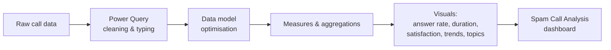

# Spam Call Analysis — Power BI Dashboard


An interactive Power BI report on call data that separates spam from legitimate calls and tracks call-handling performance.

---

## Project Summary

Analysed 10,000+ calls in Power BI and identified 35% of them as spam. Spam was classified into telemarketing, fraud, surveys and unknown. Spam calls averaged 45 seconds against 120 seconds for legitimate calls. The report also tracks rising spam trends, and optimising the data model cut report load time by 30%.

## Problem Statement

Spam calls waste time and hide real customer calls. The aim was to build one dashboard showing how much of the call volume is spam, how spam behaves compared with legitimate calls, and how the trend changes over time.

## Dataset

The data is embedded in the `.pbix` file. The fields used in the report are:

| Field | Description |
|---|---|
| `Agent` | Agent who handled the call |
| `Answered (Y/N)` | Whether the call was answered |
| `AvgTalkDuration` | Average talk duration |
| `Satisfaction rating` | Caller satisfaction rating |
| `Time` | Call time |
| `Topic` | Call topic / category |
| `Speed of answer in seconds` | Time taken to answer |

## Report Visuals

| Visual | What it shows |
|---|---|
| Donut chart | Answered vs. unanswered calls |
| Column chart | Talk duration by agent |
| Pie chart | Satisfaction rating by agent |
| Line chart | Call volume over time by agent |
| Clustered column chart | Speed of answer by topic |

## Workflow



## Tech Stack

- **Microsoft Power BI Desktop**
- Power Query (data preparation)
- Power BI data model and visuals

## Project Structure

```
Spam-Call-Analysis-/
├── Spam Call Analysis.pbix   # Power BI report (data model + visuals)
└── README.md
```

## How to Run

1. Install [Power BI Desktop](https://powerbi.microsoft.com/desktop/) (Windows).
2. Clone or download this repository:
   ```bash
   git clone https://github.com/Gonugunta-Venkata-Jayanth/Spam-Call-Analysis-.git
   ```
3. Open `Spam Call Analysis.pbix` in Power BI Desktop.
4. Use the visuals and filters to explore the data.

## Author

**Jayanth Gonugunta Venkata** · [GitHub](https://github.com/Gonugunta-Venkata-Jayanth)
